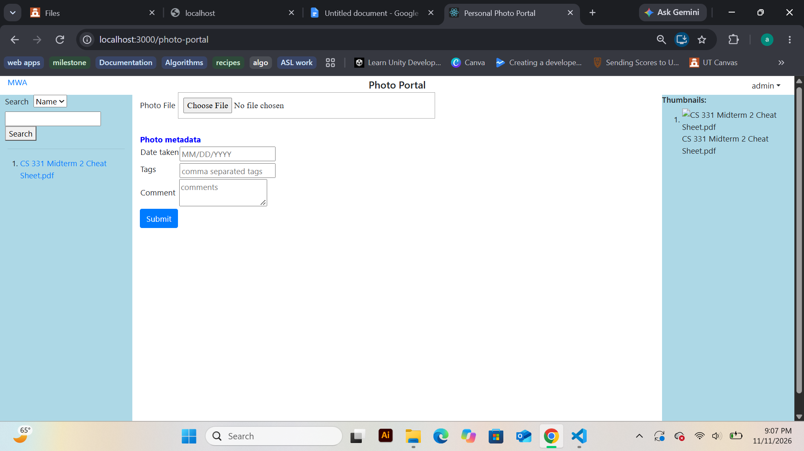

For me, I thought requirement 3.6 was difficult because I couldn't for the life of me remeber how to display text in a modal, but 
I looked back at assignment 2 to try to get a refresher and was able to find out that all I literally needed to do was add a div around what I wanted to display which I think a comment for 3.6 already had commented out for me. 

The comments Admin users can leave on their photos is the perfect example of data flowing from the react front end to the 
Flask API and database, and back to the react UI. First the user enters their comments into the textarea input box that is being 
displayed by the react UI. When the user upload their photo, the comments, tags, date_taken, and photo name are all saved as columns for the photos database, where each photo object in the database has the associated columns. When the user clicks a thumbnail, the comments for a photo are fetched from the backend's database using a GET API call. Once we have fetched the comments for a photo, we then display them in the modal that pops up on the page after the thumbnail click (right back to react display).

In order to test that requirement 1 was functioning correctly, I ran a series of commands, one to verify that each sub requirement was functioning correctly. To test requirement 1.2, I ran this command Invoke-RestMethod -Uri http://localhost:5000/api/admin -Method Post -ContentType "application/json" -Body '{"username":"admin","password":"admin123"}' and recieved this in powershell, showing that my admin user with the username admin had been added successfully into the database. 

message username
------- --------
Success admin

Next to test requirement 1.3, I ran this command Invoke-RestMethod -Uri http://localhost:5000/api/admin and recieved the following output, verifying that the GET call to api/admin returns a list of all the registered admins in the database

admins
------
{@{id=1; password=admin123; username=admin}}

I did similar testing for all the API requirements. 

To test 3.5, I logged into the photoportal web app as the admin user and confirmed that comment box 
was being displayed on the upload photo page. 

screenshot of requirement 1.4 correctly returning Success given an admin username/password combination that exists in the data base and returning not found if an incorrect password/username combination is given for an admin

screenshot of requirement 3.5 correctly displaying a textarea for comments on the upload page 

