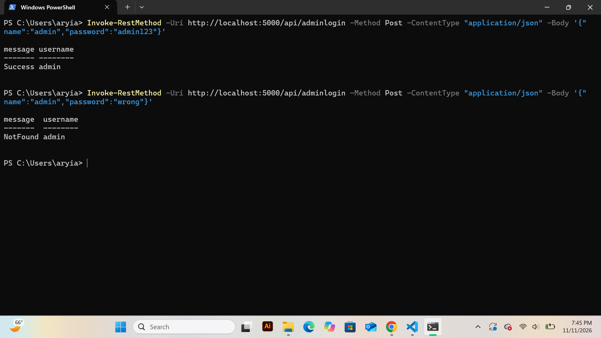

In order to test that requirement 1 was functioning correctly, I ran a series of commands, one to verify that each sub requirement was functioning correctly. To test requirement 1.2, I ran this command Invoke-RestMethod -Uri http://localhost:5000/api/admin -Method Post -ContentType "application/json" -Body '{"username":"admin","password":"admin123"}' and recieved this in powershell, showing that my admin user with the username admin had been added successfully into the database. 

message username
------- --------
Success admin

Next to test requirement 1.3, I ran this command Invoke-RestMethod -Uri http://localhost:5000/api/admin and recieved the following output, verifying that the GET call to api/admin returns a list of all the registered admins in the database

admins
------
{@{id=1; password=admin123; username=admin}}

screenshot of requirement 1.4 correctly returning Success given an admin username/password combination that exists in the data base and returning not found if an incorrect password/username combination is given for an admin

